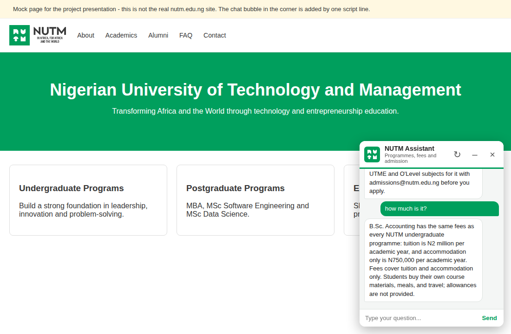
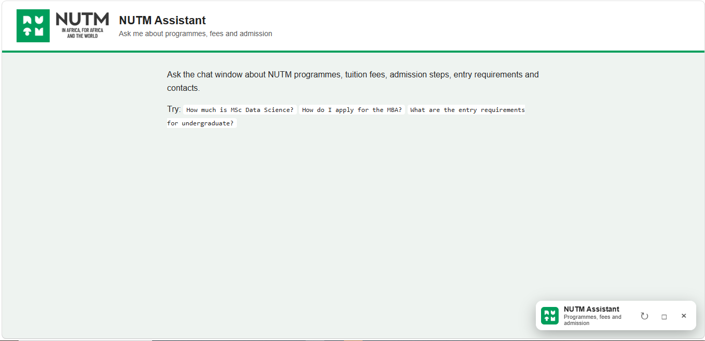

# NUTM Assistant

A question-answering chatbot for the **Nigerian University of Technology and Management (NUTM)**. It answers questions about undergraduate and postgraduate programmes, tuition fees, entry requirements, admission steps, TEDLab and contact details. It remembers the conversation, so follow-up questions work, and it can be embedded on any website with one line of code.

Built for the **Python for Data Science** course as a Python project.

> **Disclaimer:** This is a student project, not an official NUTM product. Its answers come from NUTM public materials collected in October 2026 and may become out of date. Always confirm important details (fees, deadlines, requirements) with NUTM admissions.

**Live demo:** https://nutm-chatbot.onrender.com/
**Embedded-on-a-website demo:** https://nutm-chatbot.onrender.com/demo

> The demo runs on a free hosting plan that sleeps when idle. The first visit may take about 30 seconds to wake up.


## Screenshots

| Embedded on a mock NUTM page | Minimized |
|---|---|
|  |  |

## What it can do

- **Answer NUTM questions:** programmes, fees, entry requirements, admission steps, programme length, courses, start dates, scholarships, TEDLab, Shadow a Leader, contacts and more (85 knowledge entries).
- **Give the right answer for each programme.** Ask about MSc Data Science, MSc Software Engineering, the MBA, or any undergraduate degree (Computer Science, Cybersecurity, Information Technology, Accounting, Business Administration, Entrepreneurship, Economics) and it answers for that programme. All undergraduate programmes have the same fees (N2 million tuition and N750,000 accommodation only per academic year), and it says so for whichever degree you ask about. Where NUTM has not published a detail for a programme (for example separate subject requirements for B.Sc. Accounting), it says so and points to admissions instead of guessing.
- **Continue a conversation.** "How much is the MBA?" then "what about data science?" then "how do I apply?" works, as does "tell me more". If a question is ambiguous ("how much is the fee?") it asks which programme you mean.
- **Chat politely.** It replies to greetings (even with spelling mistakes, such as "good mormning"), good afternoon/evening/night, okay, well done, thanks, goodbye, "who are you?", "help" and similar.
- **Stay honest.** Questions it cannot answer (weather, football and so on) get a friendly reply with NUTM's contact details instead of a made-up answer.

Example questions:

- "What are the entry requirements for BSc Accounting?"
- "How much is the MSc Data Science tuition?"
- "How do I apply for the MBA?"
- "What is TEDLab?"
- "Where is the campus and how do I contact admissions?"

## How it works

1. **Knowledge base:** `nutm_knowledge_base.txt` holds 85 short entries written from the NUTM website (including TEDLab, Shadow a Leader and the Scholars Program), the MSc Data Science, MSc Software Engineering and MBA brochures, and the undergraduate FAQ.
2. **Programme router:** the question is checked for a programme (for example "BSc Accounting") and a topic (fee, admission, entry requirements, duration, courses, start date). When both are found, the exact answer for that programme is returned.
3. **Retrieval:** otherwise each entry and each question is turned into a TF-IDF word vector (with simple stemming, synonyms, spelling-mistake correction and programme detection). The entry with the highest cosine similarity is returned. Off-topic questions are detected and answered with the safe fallback.
4. **Conversation memory:** after each answer the server sends back a small "context" (the programme and topic just discussed). The chat window stores it in the browser tab's session storage and sends it with the next question, so the server keeps no conversation history. Refreshing the page or moving to another page of the site continues the same chat; closing the tab ends it. The **New chat** button (the circular arrow) starts again.
5. **Web interface:** a small Python web server (`nutm_server.py`) exposes a `/chat` endpoint. A JavaScript widget (`widget.js`) provides the chat bubble with minimize, close and new-chat buttons.

There is no language model and no API key. The chatbot only returns text that exists in the knowledge base, so it does not make things up. In RAG terms, this project implements the retrieval step only.

## Project files

| File | Purpose |
|---|---|
| `nutm_chatbot.py` | The chatbot engine (matching, programme router, small talk, memory) and a terminal chat. |
| `nutm_server.py` | Web server with the `/chat` endpoint; also serves the pages and widget. |
| `nutm_knowledge_base.txt` | The knowledge base (edit this to change what the bot knows). |
| `widget.js` | Embeddable chat widget. |
| `chat.html` | Full-page chatbot. |
| `demo_site.html` | Mock NUTM homepage showing the widget embedded. |
| `nutm_logo.png`, `nutm_icon.png` | NUTM logo images used by the interface. |
| `nutm_chatbot_qr.png` | QR code that opens the live demo. |
| `make_sri.py` | Prints the integrity tag used to embed `widget.js` safely on another website. |
| `test_chatbot.py` | Automated tests (see Testing). |
| `requirements.txt` | Empty on purpose: no third-party packages are needed. |
| `.gitignore` | Keeps Python's `__pycache__` folder out of the repository. |
| `screenshots/` | Screenshots used in this README. |

## Run it on your computer

Requirements: **Python 3.8 or newer**. No pip installs and no virtual environment are needed. Keep all the files in the same folder.

```bash
python nutm_server.py
```

Your browser opens automatically:

- `http://localhost:8000/` is the full-page chatbot
- `http://localhost:8000/demo` is the mock NUTM website with the chat bubble

Options:

| Command | What it does |
|---|---|
| `python nutm_server.py --lan` | Also lets phones and computers on your Wi-Fi use it (the address is printed). |
| `python nutm_server.py --port 8080` | Uses a different port. |
| `python nutm_server.py --no-browser` | Does not open a browser tab. |

If port 8000 is busy, the server automatically tries the next ones (8001, 8002 and so on) and prints the address.

For a text-only version in the terminal: `python nutm_chatbot.py`

## Deploy online (Render, free plan)

The live version runs at **https://nutm-chatbot.onrender.com/**.

1. Push these files to a GitHub repository.
2. On [render.com](https://render.com), choose **New + → Web Service** and select the repository.
3. Use these settings:
   - Language: **Python 3**
   - Build command: `pip install -r requirements.txt`
   - Start command: `python nutm_server.py`
   - Instance type: **Free**
4. Add the environment variable `ALLOWED_ORIGINS` (see Security below), then deploy.

The same `nutm_server.py` works on Render and on your computer: when the host provides a `PORT` (as Render does), the server listens on all network interfaces on that port; on your computer it listens on `127.0.0.1:8000`. `HOST` and `PORT` can also be set as environment variables.

## Embed it on a website

After the chatbot is hosted, add one line before the closing `</body>` tag of any page:

```html
<script src="https://nutm-chatbot.onrender.com/widget.js"></script>
```

Add `data-open="true"` to the script tag to start with the chat window open. See "Embedding safely on nutm.edu.ng" below for the safer options.

## Update or extend the knowledge base

Open `nutm_knowledge_base.txt` and add an entry in this format:

```
### Short title of the entry
keywords: words, people, might, use, when, asking
The answer text the chatbot should reply with.
```

Keywords are not shown to users. They help the bot match different wordings of the same question. Restart the server after editing, run `python test_chatbot.py`, and change the "last updated" line at the top of the file.

## Testing

Run `python test_chatbot.py`. It checks:

| Check | Result |
|---|---|
| 47 NUTM questions return the right entry (including TEDLab and spelling mistakes) | 47/47 first choice |
| 12 off-topic questions get the safe fallback | 12/12 |
| 15 greetings and 36 small-talk variants (spelling mistakes, good morning/afternoon/night, okay, well done, thanks...) | all answered |
| Every programme x topic pair (3 postgraduate programmes, 7 undergraduate degrees, and undergraduate in general; fee, entry requirements, admission, duration, courses, start date; several phrasings each) | 195/195 |
| Follow-up conversations ("what about data science?", "how do I apply?", "tell me more", clarifying questions) | 18/18 |
| 34 odd inputs (empty, emoji, 1,000 characters, HTML, SQL, other languages) | no failures |
| Tampered conversation context | cleaned safely |

The first 47 questions were used while tuning the rules, so they flatter the result. On a separate set of 22 new questions written before the final wording fixes, the first-choice answer was right 77% of the time (91% within the top three); a later spot check of 16 more new questions found the right fact in 16 answers after two fixes. Treat roughly 80-90% as the realistic accuracy for new wording.

## Security and hosting settings

Built in:

- Request size is capped (4 KB), questions are cut to 200 characters, stalled connections are dropped after 10 seconds, and malformed requests get a clear error.
- Each visitor is limited to 120 questions per minute (`RATE_LIMIT`) and everyone together to 600 per minute (`GLOBAL_RATE_LIMIT`). The visitor address comes from the proxy-added part of `X-Forwarded-For`, so it cannot be faked from the left (`TRUSTED_PROXY_HOPS`, default 1).
- At most 50 requests are handled at once (`MAX_CONNECTIONS`); extra requests get a 503.
- Spell-checking is limited to 12 words per question, so a long nonsense message cannot use up the processor.
- HTML pages are sent with a Content-Security-Policy, `X-Frame-Options` and `Referrer-Policy`; HTTPS responses add `Strict-Transport-Security`. The server does not reveal its Python version.
- Visitors' questions are never saved or logged by the server; log lines have control characters removed. `/health` is available for hosting health checks.
- The conversation is kept only in the visitor's own browser tab (session storage). The context the browser sends back is validated against known values.
- The chat window sends no cookies and is keyboard- and screen-reader-friendly (labelled input, live message region, Escape closes the window).

Settings you should make when you host it:

- `ALLOWED_ORIGINS`: the websites allowed to use or embed the chatbot, for example `ALLOWED_ORIGINS=https://nutm-chatbot.onrender.com,https://www.nutm.edu.ng`. If it is not set, any website can use the chatbot and the server prints a warning.

## Embedding safely on nutm.edu.ng

A script loaded from another website runs with full control of the page that loads it, so prefer one of these, safest first:

1. **NUTM hosts the files itself.** NUTM copies `widget.js` and the two logo images to its own server and the widget points at your chatbot server only for answers.
2. **Iframe.** Add `<iframe src="https://nutm-chatbot.onrender.com/" title="NUTM Assistant"></iframe>` and set `ALLOWED_ORIGINS` to include nutm.edu.ng so the page may be framed there.
3. **Script with an integrity hash.** Run `python make_sri.py https://nutm-chatbot.onrender.com/widget.js` and paste the tag it prints. The browser then refuses to run the script if it has been altered. Re-run it every time `widget.js` changes.

## Account and repository checklist

Whoever controls your GitHub or hosting account controls what the chatbot tells applicants, so:

- Turn on two-step verification for GitHub and for your hosting account.
- Protect the `main` branch (require a pull request before changes to `nutm_knowledge_base.txt` or the code).
- Never put passwords or keys in the repository (the app needs none).
- Keep the knowledge base up to date and change the "last updated" line when you edit it.

## Limitations

- Matching is mostly by words, not meaning, so very unusual phrasings can miss the right entry.
- Memory is basic: it remembers the programme and topic of the last questions, not a long conversation.
- It cannot answer general-knowledge questions (weather, sport and so on); it says so and shares NUTM's contacts.
- The knowledge base is updated by hand. Several NUTM details (such as the September 2026 start dates) may already be out of date.
- Where NUTM has not published a detail for a programme (for example per-programme details beyond the general entry requirements), the bot says so rather than guessing.
- English only.
- The free hosting plan sleeps after about 15 minutes of inactivity.

## Possible improvements

- Semantic search with sentence embeddings for better understanding of rephrased questions
- A language model to turn retrieved passages into natural answers (full RAG) and to handle general questions
- Longer conversation memory
- A Telegram bot using the same engine
- Nigerian languages (Pidgin, Yoruba, Hausa, Igbo)
- An automatic scraper that refreshes the knowledge base from nutm.edu.ng

## Data sources

- NUTM website (nutm.edu.ng): home, about, academics, undergraduate, postgraduate, executive education and career pages
- NUTM MSc Data Science, MSc Software Engineering and 2026 MBA programme brochures
- NUTM undergraduate FAQ page
- Early news coverage of the NUTM Scholars Program (for the TEDLab figures; reported, not independently verified)

NUTM names, logos and content belong to the Nigerian University of Technology and Management.

## Author

Chinasa Priscilla Emeji, MSc Data Science, Nigerian University of Technology and Management.
Course: Python for Data Science.
